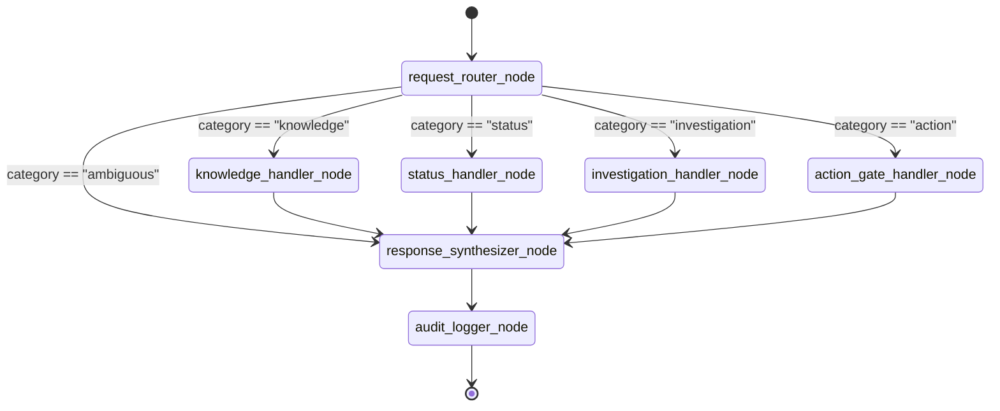
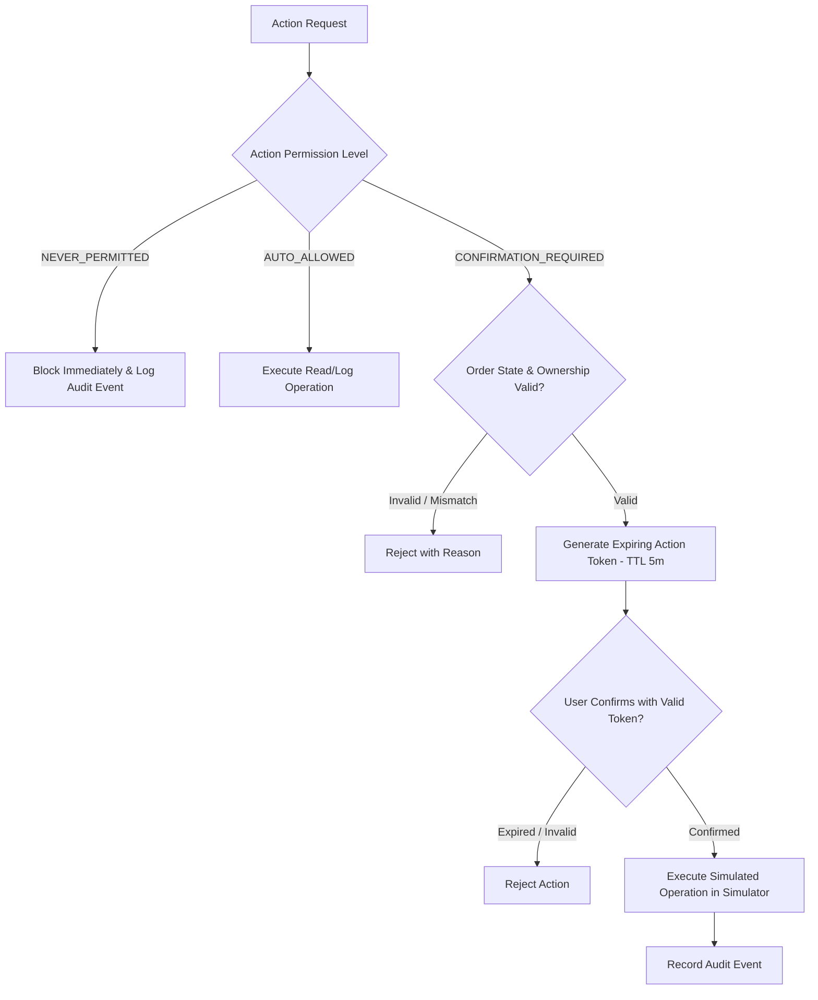

# ShopGuard AI — System Architecture Specification

## 1. Executive Architecture Overview

ShopGuard AI is an e-commerce operations co-pilot designed to resolve order issues, evaluate refund eligibility, retrieve policy knowledge, and safely control operational actions.

The system enforces a strict **deterministic-first** boundary:
- **No LLM in request routing**: All classification uses deterministic Python regex and pattern matching.
- **No LLM in action authorization**: Action gates enforce permission levels (`AUTO_ALLOWED`, `CONFIRMATION_REQUIRED`, `NEVER_PERMITTED`) deterministically.
- **LLM as an explainer only**: Groq API is invoked strictly for natural language synthesis from verified facts. If Groq is offline or rate-limited, deterministic templates take over.
- **Fail-Closed Security**: Data ownership is validated prior to any order query or action.

---

## 2. Mermaid System Architecture Diagram

```mermaid
flowchart TD
    subgraph ClientLayer [Client & User Interface]
        User([Customer / Support Agent])
        StreamlitUI["Streamlit UI (Port 8501)"]
    end

    subgraph BackendLayer [ShopGuard Co-Pilot Backend (Port 8010)]
        FastAPI["FastAPI Gateway"]
        AuthCheck["Customer Ownership & Session Auth"]
        Cache["Semantic Cache (Memory + TTL)"]
        RateLimit["Rate Limiter (Per-Session / Global)"]

        Router["Deterministic Request Router\n(Pure Python Patterns / RegEx)"]

        subgraph LangGraphOrchestrator [LangGraph Workflow Engine]
            direction TB
            NodeRouter["request_router_node"]
            NodeRAG["knowledge_handler_node"]
            NodeStatus["status_handler_node"]
            NodeInvestigate["investigation_handler_node"]
            NodeAction["action_gate_handler_node"]
            NodeResponse["response_synthesizer_node"]
            NodeAudit["audit_logger_node"]
        end

        subgraph SpecializedTools [Specialized Domain Tools]
            ToolRAG["RAG Knowledge Tool\n(ChromaDB + all-MiniLM-L6-v2)"]
            ToolStatus["Status Tool\n(HTTP Client / Rest Client)"]
            ToolInvestigate["Incident Investigation Tool\n(Timeline & Delay Heuristics)"]
            ToolActionGate["Deterministic Action Gate\n(3-Tier Permissions)"]
            MLRisk["Optional ML Risk Service\n(Scikit-Learn Classifier)"]
        end

        LLMService["Groq LLM Service\n(Official Groq SDK / Free Tier)"]
        FallbackEngine["Deterministic Template Engine\n(Offline Fallback)"]
    end

    subgraph SimulatorLayer [E-Commerce Simulator (Port 8002)]
        SimAPI["Simulator FastAPI"]
        SimEngine["Scenario & Order Engine"]
        SimDB[(SQLite: simulator.db)]
    end

    subgraph StorageLayer [Persistence & Audit]
        ShopGuardDB[(SQLite: shopguard.db)]
        ChromaStore[(ChromaDB Vector Store)]
        JSONLLog["JSONL Audit Trails\n(logs/audit.jsonl)"]
    end

    %% Flow connections
    User -->|Interacts| StreamlitUI
    StreamlitUI -->|REST / JSON| FastAPI
    FastAPI --> RateLimit
    RateLimit --> AuthCheck
    AuthCheck --> Cache
    Cache -->|Miss| NodeRouter
    Cache -->|Hit| StreamlitUI

    %% LangGraph Routing
    NodeRouter --> Router
    Router -->|Category: Knowledge| NodeRAG
    Router -->|Category: Status| NodeStatus
    Router -->|Category: Investigation| NodeInvestigate
    Router -->|Category: Action| NodeAction

    %% Tool execution
    NodeRAG --> ToolRAG
    ToolRAG --> ChromaStore

    NodeStatus --> ToolStatus
    ToolStatus -->|HTTP GET| SimAPI

    NodeInvestigate --> ToolInvestigate
    ToolInvestigate -->|HTTP GET events| SimAPI
    ToolInvestigate -.-> MLRisk

    NodeAction --> ToolActionGate
    ToolActionGate -->|Validated Mutation| SimAPI

    %% Response synthesis
    NodeRAG --> NodeResponse
    NodeInvestigate --> NodeResponse
    NodeStatus --> NodeResponse
    NodeAction --> NodeResponse

    NodeResponse --> LLMService
    LLMService -.->|Fallback on error / 429| FallbackEngine

    %% Audit logging
    NodeResponse --> NodeAudit
    NodeAudit --> ShopGuardDB
    NodeAudit --> JSONLLog

    %% Simulator DB
    SimAPI --> SimEngine
    SimEngine --> SimDB
```

---

## 3. Component Responsibilities

| Component | Port / Location | Primary Responsibility | Deterministic vs LLM |
|---|---|---|---|
| **E-commerce Simulator** | `8002` | Maintains orders, shipments, customer records, and scenario injection. | Deterministic |
| **ShopGuard Backend** | `8010` | Central FastAPI gateway, session verification, and orchestration entry point. | Deterministic |
| **Streamlit Dashboard** | `8501` | Customer chat, operator review, investigation view, and diagnostics. | UI Only |
| **Request Router** | `src/shopguard/router/` | Fast pattern classification into 4 explicit categories. | **100% Deterministic** |
| **RAG Knowledge Tool** | `src/shopguard/tools/` | Semantic search over Markdown policies via ChromaDB. | Vector Retrieval |
| **Status Tool** | `src/shopguard/tools/` | Fetches live order, delivery, and shipment timeline from Simulator. | Deterministic |
| **Investigation Tool** | `src/shopguard/tools/` | Chronological event analysis, delay detection, and discrepancy finding. | Deterministic Logic |
| **Deterministic Action Gate** | `src/shopguard/tools/` | Enforces 3-tier safety policies; handles expiring confirmation tokens. | **100% Deterministic** |
| **Groq LLM Service** | `src/shopguard/services/` | Formats grounded answers and explanations using Free-Tier Groq API. | LLM (Grounded) |
| **Fallback Engine** | `src/shopguard/services/` | Generates structured markdown responses if Groq fails or rate limits. | Deterministic |

---

## 4. Data Flow Between Services

1. **Inbound Request**: User message arrives at Streamlit UI with `customer_id` and optional `session_id`.
2. **API Ingestion**: Streamlit calls `POST http://localhost:8010/api/chat`.
3. **Security Check**: Backend checks customer existence and order ownership against `customer_id`.
4. **Cache & Rate Check**: Evaluates per-session rate limits and semantic cache for policy queries.
5. **Deterministic Routing**: Router analyzes message using keyword sets and regex heuristics.
6. **Tool Invocation**:
   - **Knowledge**: ChromaDB retrieves top-$k$ policy chunks (threshold filtered).
   - **Status**: Backend queries Simulator at `http://localhost:8002/orders/{order_id}`.
   - **Investigation**: Backend queries Simulator for `/orders/{order_id}/events`, compares expected vs actual delivery dates, and assesses anomalies.
   - **Action**: Action Gate determines if action is `AUTO_ALLOWED`, `CONFIRMATION_REQUIRED`, or `NEVER_PERMITTED`.
7. **Synthesis**:
   - If Groq is reachable and enabled, generates concise explanation grounded in retrieved facts.
   - If Groq is unreachable, deterministic template formats output with evidence citations.
8. **Audit Trail**: Appends structured JSON record to `shopguard.db` and `logs/audit.jsonl`.
9. **UI Display**: Formatted response with evidence tags, citations, and confirmation buttons returned to UI.

---

## 5. LangGraph Workflow Architecture

The state transitions strictly enforce conditional branching based on router output:



### Shared State Schema (`ShopGuardState`)
```python
class ShopGuardState(TypedDict, total=False):
    request_id: str
    session_id: str
    customer_id: str
    user_message: str

    category: Literal["knowledge", "status", "investigation", "action", "ambiguous"]
    router_reason: str
    matched_rule: str
    target_tool: str

    order_id: Optional[str]
    order_data: Optional[dict]
    shipment_events: Optional[list]

    policy_chunks: Optional[list]
    evidence: Optional[list]

    investigation_result: Optional[dict]
    action_decision: Optional[Literal["AUTO_ALLOWED", "CONFIRMATION_REQUIRED", "NEVER_PERMITTED"]]
    pending_confirmation: Optional[dict]

    llm_used: bool
    final_response: str
    error: Optional[str]
    trace: list[dict]
```

---

## 6. Request Router Architecture

The Router uses prioritized rule evaluation:

```
Input Message
     │
     ▼
[Action Rule Engine] ──────► Matched? ──YES──► Category: ACTION
     │ NO
     ▼
[Investigation Rule Engine] ─► Matched? ──YES──► Category: INVESTIGATION
     │ NO
     ▼
[Status Rule Engine] ────────► Matched? ──YES──► Category: STATUS
     │ NO
     ▼
[Knowledge Rule Engine] ─────► Matched? ──YES──► Category: KNOWLEDGE
     │ NO
     ▼
[Fallback Handler] ─────────► Category: AMBIGUOUS (Safe escalation)
```

1. **Action Priority**: Explicit verbs (`cancel`, `refund`, `return`, `escalate`) are evaluated first to prevent dangerous misinterpretations.
2. **Investigation Priority**: Diagnostic keywords (`why`, `delayed`, `stuck`, `lost`, `late`) combined with order references.
3. **Status Priority**: Inquiries regarding whereabouts (`where is`, `track`, `status of`, `has it shipped`).
4. **Knowledge Priority**: Policy queries (`policy`, `how many days`, `procedure`, `eligibility`).
5. **Ambiguity Gate**: Low-confidence or contradictory matches route to `AMBIGUOUS`, triggering a clarification prompt or human support referral.

---

## 7. RAG and Groq Integration

### RAG Pipeline (ChromaDB + ONNX Embeddings)
- **Document Chunking**: Markdown policy files split into semantic sections with metadata (`policy_type`, `version`, `last_updated`).
- **Embedding Model**: `all-MiniLM-L6-v2` loaded locally via ONNX/ChromaDB.
- **Query Processing**: Synonym expansion (e.g., "broken" $\to$ "damaged", "money back" $\to$ "refund") applied to user query.
- **Threshold Gate**: Results with cosine distance $> 0.45$ (or similarity score $< 0.55$) are rejected as ungrounded, triggering a "Policy not found / Escalate" response.

### Groq API Integration & Guardrails
- **SDK**: `groq` official client.
- **Environment Settings**: `GROQ_API_KEY`, `GROQ_MODEL=llama-3.1-8b-instant`.
- **System Prompt**: Enforces strict grounding: *"Only answer using the provided verified context. Do not invent facts, policies, or order details."*
- **Bounded Retries & 429 Handling**: Max 2 retries with exponential backoff honoring `Retry-After`.
- **Deterministic Fallback**: If Groq call throws any exception or times out (>5s), deterministic string formatters generate the response immediately.

---

## 8. Deterministic Action Gate

The Action Gate is a zero-trust policy engine:



### Action Matrix
- **`AUTO_ALLOWED`**: Status checks, reading policies, creating internal investigation tickets.
- **`CONFIRMATION_REQUIRED`**:
  - Cancel order (only if order status is `PLACED` or `PROCESSING`, not yet `SHIPPED`).
  - Submit refund review request (only if delivered within 30 days policy window).
  - Submit return request.
- **`NEVER_PERMITTED`**:
  - Direct financial transfer / bank refund execution.
  - Card/account detail modification.
  - Deleting audit logs.
  - Overriding customer ownership.
