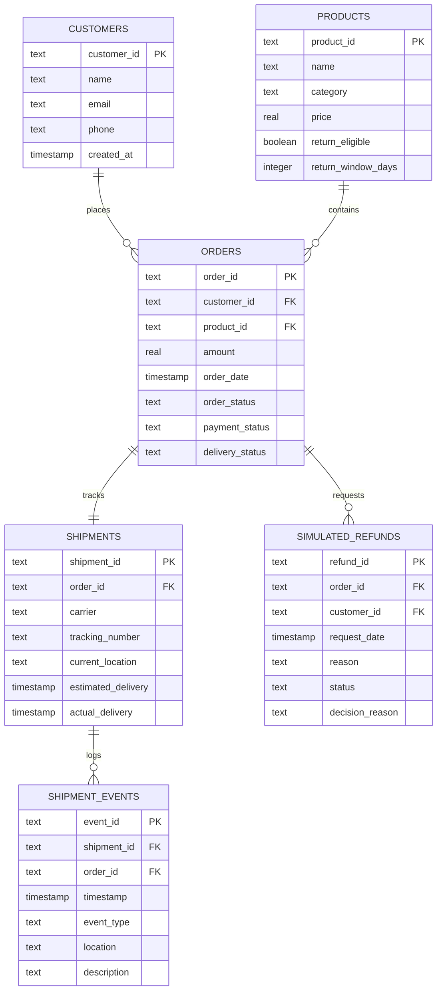
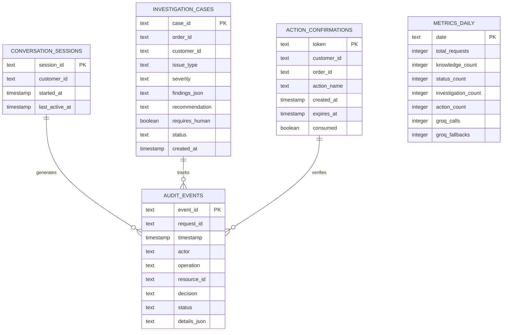

# ShopGuard AI — Database Schema Specification

This document defines the physical data models and schema definitions for both SQLite databases:
1. **Simulator Database** (`data/simulator.db`) — Port 8002
2. **ShopGuard Co-Pilot Database** (`data/shopguard.db`) — Port 8010

---

## 1. Simulator Database Schema (`data/simulator.db`)

The simulator stores mock e-commerce operations data.



### Table DDL Statements

```sql
-- Customers Table
CREATE TABLE IF NOT EXISTS customers (
    customer_id TEXT PRIMARY KEY,
    name TEXT NOT NULL,
    email TEXT NOT NULL UNIQUE,
    phone TEXT,
    created_at TIMESTAMP DEFAULT CURRENT_TIMESTAMP
);

-- Products Table
CREATE TABLE IF NOT EXISTS products (
    product_id TEXT PRIMARY KEY,
    name TEXT NOT NULL,
    category TEXT NOT NULL,
    price REAL NOT NULL CHECK(price >= 0),
    return_eligible INTEGER NOT NULL DEFAULT 1 CHECK(return_eligible IN (0, 1)),
    return_window_days INTEGER NOT NULL DEFAULT 30
);

-- Orders Table
CREATE TABLE IF NOT EXISTS orders (
    order_id TEXT PRIMARY KEY,
    customer_id TEXT NOT NULL REFERENCES customers(customer_id) ON DELETE RESTRICT,
    product_id TEXT NOT NULL REFERENCES products(product_id) ON DELETE RESTRICT,
    amount REAL NOT NULL CHECK(amount >= 0),
    order_date TIMESTAMP NOT NULL DEFAULT CURRENT_TIMESTAMP,
    order_status TEXT NOT NULL CHECK(order_status IN ('PLACED', 'PROCESSING', 'SHIPPED', 'DELIVERED', 'CANCELLED')),
    payment_status TEXT NOT NULL CHECK(payment_status IN ('PENDING', 'PAID', 'FAILED', 'REFUNDED')),
    delivery_status TEXT NOT NULL CHECK(delivery_status IN ('PENDING', 'IN_TRANSIT', 'OUT_FOR_DELIVERY', 'DELIVERED', 'DELAYED', 'RETURNED'))
);
CREATE INDEX IF NOT EXISTS idx_orders_customer ON orders(customer_id);
CREATE INDEX IF NOT EXISTS idx_orders_status ON orders(order_status);

-- Shipments Table
CREATE TABLE IF NOT EXISTS shipments (
    shipment_id TEXT PRIMARY KEY,
    order_id TEXT NOT NULL UNIQUE REFERENCES orders(order_id) ON DELETE RESTRICT,
    carrier TEXT NOT NULL,
    tracking_number TEXT NOT NULL UNIQUE,
    current_location TEXT NOT NULL,
    estimated_delivery TIMESTAMP NOT NULL,
    actual_delivery TIMESTAMP
);
CREATE INDEX IF NOT EXISTS idx_shipments_order ON shipments(order_id);

-- Shipment Events Table
CREATE TABLE IF NOT EXISTS shipment_events (
    event_id TEXT PRIMARY KEY,
    shipment_id TEXT NOT NULL REFERENCES shipments(shipment_id) ON DELETE CASCADE,
    order_id TEXT NOT NULL REFERENCES orders(order_id) ON DELETE CASCADE,
    timestamp TIMESTAMP NOT NULL DEFAULT CURRENT_TIMESTAMP,
    event_type TEXT NOT NULL,
    location TEXT NOT NULL,
    description TEXT NOT NULL
);
CREATE INDEX IF NOT EXISTS idx_events_order_time ON shipment_events(order_id, timestamp);

-- Simulated Refunds Table
CREATE TABLE IF NOT EXISTS simulated_refunds (
    refund_id TEXT PRIMARY KEY,
    order_id TEXT NOT NULL REFERENCES orders(order_id) ON DELETE RESTRICT,
    customer_id TEXT NOT NULL REFERENCES customers(customer_id) ON DELETE RESTRICT,
    request_date TIMESTAMP NOT NULL DEFAULT CURRENT_TIMESTAMP,
    reason TEXT NOT NULL,
    status TEXT NOT NULL CHECK(status IN ('PENDING_REVIEW', 'APPROVED_SIMULATED', 'REJECTED_SIMULATED')),
    decision_reason TEXT
);
CREATE INDEX IF NOT EXISTS idx_refunds_order ON simulated_refunds(order_id);
CREATE INDEX IF NOT EXISTS idx_refunds_customer ON simulated_refunds(customer_id);
```

---

## 2. ShopGuard Co-Pilot Database Schema (`data/shopguard.db`)

The co-pilot database stores operational intelligence, investigation cases, action tokens, and append-only audit records.



### Table DDL Statements

```sql
-- Conversation Sessions Table
CREATE TABLE IF NOT EXISTS conversation_sessions (
    session_id TEXT PRIMARY KEY,
    customer_id TEXT NOT NULL,
    started_at TIMESTAMP DEFAULT CURRENT_TIMESTAMP,
    last_active_at TIMESTAMP DEFAULT CURRENT_TIMESTAMP
);

-- Investigation Cases Table
CREATE TABLE IF NOT EXISTS investigation_cases (
    case_id TEXT PRIMARY KEY,
    order_id TEXT NOT NULL,
    customer_id TEXT NOT NULL,
    issue_type TEXT NOT NULL,
    severity TEXT NOT NULL CHECK(severity IN ('low', 'medium', 'high', 'critical')),
    findings_json TEXT NOT NULL,
    recommendation TEXT NOT NULL,
    requires_human INTEGER NOT NULL DEFAULT 0 CHECK(requires_human IN (0, 1)),
    status TEXT NOT NULL DEFAULT 'OPEN' CHECK(status IN ('OPEN', 'IN_REVIEW', 'RESOLVED', 'DISMISSED')),
    created_at TIMESTAMP DEFAULT CURRENT_TIMESTAMP
);
CREATE INDEX IF NOT EXISTS idx_cases_order ON investigation_cases(order_id);
CREATE INDEX IF NOT EXISTS idx_cases_customer ON investigation_cases(customer_id);

-- Action Confirmations (Expiring Tokens)
CREATE TABLE IF NOT EXISTS action_confirmations (
    token TEXT PRIMARY KEY,
    customer_id TEXT NOT NULL,
    order_id TEXT NOT NULL,
    action_name TEXT NOT NULL,
    payload_json TEXT,
    created_at TIMESTAMP DEFAULT CURRENT_TIMESTAMP,
    expires_at TIMESTAMP NOT NULL,
    consumed INTEGER NOT NULL DEFAULT 0 CHECK(consumed IN (0, 1))
);
CREATE INDEX IF NOT EXISTS idx_action_token_expiry ON action_confirmations(expires_at, consumed);

-- Append-Only Audit Events Table
CREATE TABLE IF NOT EXISTS audit_events (
    event_id TEXT PRIMARY KEY,
    request_id TEXT NOT NULL,
    timestamp TIMESTAMP DEFAULT CURRENT_TIMESTAMP,
    actor TEXT NOT NULL,
    operation TEXT NOT NULL,
    resource_id TEXT,
    decision TEXT NOT NULL CHECK(decision IN ('AUTO_ALLOWED', 'CONFIRMATION_REQUIRED', 'NEVER_PERMITTED', 'INFO_ONLY')),
    status TEXT NOT NULL CHECK(status IN ('SUCCESS', 'DENIED', 'FAILED', 'ESCALATED')),
    details_json TEXT
);
CREATE INDEX IF NOT EXISTS idx_audit_time ON audit_events(timestamp);
CREATE INDEX IF NOT EXISTS idx_audit_resource ON audit_events(resource_id);

-- Daily Telemetry Metrics Table
CREATE TABLE IF NOT EXISTS metrics_daily (
    date TEXT PRIMARY KEY,
    total_requests INTEGER DEFAULT 0,
    knowledge_count INTEGER DEFAULT 0,
    status_count INTEGER DEFAULT 0,
    investigation_count INTEGER DEFAULT 0,
    action_count INTEGER DEFAULT 0,
    groq_calls INTEGER DEFAULT 0,
    groq_fallbacks INTEGER DEFAULT 0
);
```

---

## 3. Audit Logging Structure & Dual Write

To guarantee audit trails cannot be tampered with or lost:
1. Every write to the `audit_events` SQLite table is simultaneously mirrored as an append-only JSON line into `logs/audit.jsonl`.
2. Format of each JSONL line:
```json
{
  "event_id": "AUD-5521",
  "request_id": "REQ-77891",
  "timestamp": "2026-11-01T14:15:02Z",
  "actor": "CUST-001",
  "operation": "INVESTIGATE_ORDER",
  "resource_id": "ORD-1004",
  "decision": "AUTO_ALLOWED",
  "status": "SUCCESS",
  "details": {
    "issue": "delivery_delay",
    "hub": "Regional Sorting Hub Pune"
  }
}
```
3. Privacy rule: No customer passwords, credit card numbers, or full private messages are stored in either `audit_events` or `audit.jsonl`.
