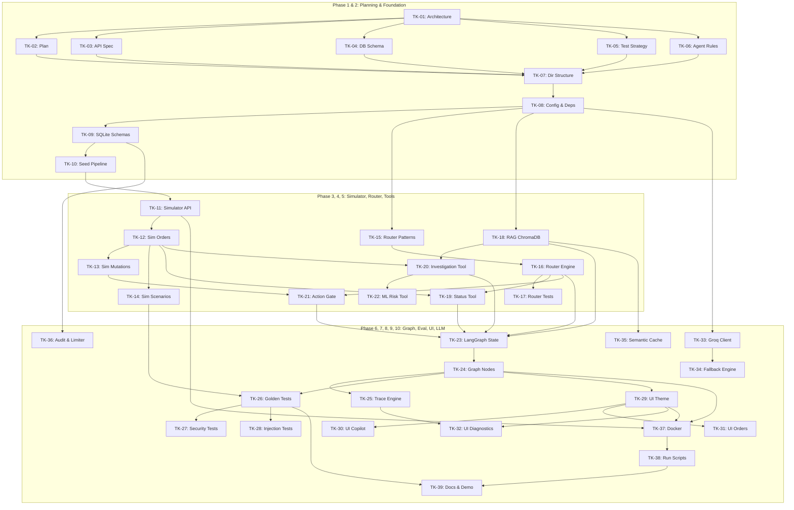

# ShopGuard AI — Implementation Plan & Ticket Breakdown

## 1. Development Phases Overview

The 7-day development roadmap is broken into 10 structured phases:

| Phase | Title | Key Deliverable | Est. Tickets |
|---|---|---|---|
| **Phase 1** | Architecture & Specifications | Architecture, plan, API specs, schemas, strategy | TK-01 to TK-06 |
| **Phase 2** | Project Foundation & Schemas | Directory structure, SQLite setup, seed scripts, `.env` | TK-07 to TK-10 |
| **Phase 3** | E-commerce Simulator (Port 8002) | FastAPI simulator, dynamic order engine, scenario injector | TK-11 to TK-14 |
| **Phase 4** | Deterministic Request Router | Regex/pattern matching engine & unit tests | TK-15 to TK-17 |
| **Phase 5** | Specialized Tools Implementation | RAG tool, Status tool, Investigation tool, Action Gate | TK-18 to TK-22 |
| **Phase 6** | LangGraph Orchestration | Graph state, conditional edges, trace collection | TK-23 to TK-25 |
| **Phase 7** | Evaluation & Security Suite | 10 Golden Scenarios runner, security exploit tests | TK-26 to TK-28 |
| **Phase 8** | Streamlit Dashboard (Port 8501) | Multi-page UI, customer co-pilot, operator reviews | TK-29 to TK-32 |
| **Phase 9** | Groq Integration & Resilience | Groq SDK, fallbacks, semantic cache, rate limiter | TK-33 to TK-36 |
| **Phase 10** | Hardening, Docs & Final Packaging | Docker, run scripts, final verification | TK-37 to TK-39 |

---

## 2. Implementable Ticket Specifications

### Phase 1: Planning and Architecture
- **TK-01: Core Architecture & Workflow Design**
  - *Dependencies*: None
  - *Acceptance Criteria*: Complete `ARCHITECTURE.md` with Mermaid diagrams, router design, and data flows.
- **TK-02: Implementation Roadmap & Ticket Definitions**
  - *Dependencies*: TK-01
  - *Acceptance Criteria*: Complete `IMPLEMENTATION_PLAN.md` with acceptance criteria and dependency graphs.
- **TK-03: API & Protocol Specification**
  - *Dependencies*: TK-01
  - *Acceptance Criteria*: Complete `API_SPEC.md` covering all endpoints for ports 8002 and 8010.
- **TK-04: Database Schema & Entity Relationships**
  - *Dependencies*: TK-01
  - *Acceptance Criteria*: Complete `DATABASE_SCHEMA.md` with table DDLs for simulator and co-pilot databases.
- **TK-05: Comprehensive Testing Strategy**
  - *Dependencies*: TK-01, TK-03
  - *Acceptance Criteria*: Complete `TESTING_STRATEGY.md` with golden test definitions and expected outputs.
- **TK-06: Agent Guidelines & Safety Guardrails**
  - *Dependencies*: None
  - *Acceptance Criteria*: Complete `AGENTS.md` enforcing Python 3.11.15, zero-paid policy, and security rules.

---

### Phase 2: Project Foundation & Environment Setup
- **TK-07: Project Directory Structure & Git Configuration**
  - *Dependencies*: TK-01 to TK-06
  - *Acceptance Criteria*: Folder tree created matching PRD Section 15. `.gitignore` validated.
- **TK-08: Configuration Management & Dependency Specification**
  - *Dependencies*: TK-07
  - *Acceptance Criteria*: `requirements.txt` crafted with Python 3.11-compatible versions; `config.py` loading `.env`.
- **TK-09: SQLite Database Initialization & Migrations**
  - *Dependencies*: TK-04, TK-08
  - *Acceptance Criteria*: Scripts initialize `data/simulator.db` and `data/shopguard.db` with foreign keys enabled.
- **TK-10: Synthetic Data Seeding Pipeline**
  - *Dependencies*: TK-09
  - *Acceptance Criteria*: `scripts/seed_data.py` populates 10+ customers, 20+ products, 30+ orders across multiple statuses.

---

### Phase 3: E-commerce Simulator (Port 8002)
- **TK-11: Simulator FastAPI Application & Health Probe**
  - *Dependencies*: TK-09, TK-10
  - *Acceptance Criteria*: FastAPI app starts on port 8002; `/health` returns `{status: "healthy", port: 8002}`.
- **TK-12: Simulator Order & Shipment Endpoints**
  - *Dependencies*: TK-11
  - *Acceptance Criteria*: Endpoints `/customers/{id}/orders`, `/orders/{id}`, `/orders/{id}/events` return structured data.
- **TK-13: Simulator Order Mutation & Cancellation Logic**
  - *Dependencies*: TK-12
  - *Acceptance Criteria*: `POST /orders/{id}/cancel` succeeds only for unfulfilled orders; `POST /refunds/request` logs refund.
- **TK-14: Admin Scenario Injection Engine**
  - *Dependencies*: TK-12
  - *Acceptance Criteria*: `POST /admin/scenarios/inject` dynamically overrides order delay, stuck hub, or damaged package.

---

### Phase 4: Deterministic Request Router
- **TK-15: Router Regular Expressions & Keyword Catalog**
  - *Dependencies*: TK-08
  - *Acceptance Criteria*: `src/shopguard/router/patterns.py` defines priority sets for Action, Investigation, Status, Knowledge.
- **TK-16: Core Router Classification Engine**
  - *Dependencies*: TK-15
  - *Acceptance Criteria*: `route_request(text)` returns `RouterResult` without any LLM invocation.
- **TK-17: Request Router Unit Test Suite**
  - *Dependencies*: TK-16
  - *Acceptance Criteria*: 100% pass on 50+ diverse test queries covering all 4 categories and ambiguous queries.

---

### Phase 5: Specialized Tools Implementation
- **TK-18: Policy Knowledge Ingestion & ChromaDB RAG Tool**
  - *Dependencies*: TK-08
  - *Acceptance Criteria*: Markdown policies indexed in ChromaDB; `retrieve_policy(query)` returns top chunks with similarity scores.
- **TK-19: Simulator HTTP Client & Status Tool**
  - *Dependencies*: TK-12, TK-16
  - *Acceptance Criteria*: Status tool fetches verified tracking and shipment status with ownership checks.
- **TK-20: Incident Investigation Engine**
  - *Dependencies*: TK-12, TK-18
  - *Acceptance Criteria*: Chronological timeline validator detects delays, passes findings, and sets severity flags.
- **TK-21: Deterministic Action Gate Policy Engine**
  - *Dependencies*: TK-13, TK-16
  - *Acceptance Criteria*: Evaluates `AUTO_ALLOWED`, `CONFIRMATION_REQUIRED`, `NEVER_PERMITTED`; issues 5-minute confirmation tokens.
- **TK-22: Optional ML Refund-Risk Scoring Service**
  - *Dependencies*: TK-20
  - *Acceptance Criteria*: Scikit-learn classifier computes risk score (0.0 to 1.0) on synthetic customer behavior features.

---

### Phase 6: LangGraph Orchestration
- **TK-23: LangGraph State Definition & Schema**
  - *Dependencies*: TK-16, TK-18, TK-21
  - *Acceptance Criteria*: `ShopGuardState` defined with complete typed attributes and trace history.
- **TK-24: Graph Nodes & Conditional Routing Workflow**
  - *Dependencies*: TK-23
  - *Acceptance Criteria*: Graph cleanly branches from `request_router_node` to specialized tool nodes based on router output.
- **TK-25: Execution Tracing & State Context Aggregator**
  - *Dependencies*: TK-24
  - *Acceptance Criteria*: Every execution captures node runtimes, evidence, and tool outputs in `trace` list.

---

### Phase 7: Evaluation & Security Suite
- **TK-26: Golden Scenarios Definition & Runner**
  - *Dependencies*: TK-14, TK-24
  - *Acceptance Criteria*: Runner executes all 10 Golden Scenarios (SG-01 to SG-10) and outputs pass/fail status.
- **TK-27: Ownership & Cross-Customer Security Tests**
  - *Dependencies*: TK-26
  - *Acceptance Criteria*: Confirms Customer A cannot query Customer B's orders or trigger unauthorized refunds.
- **TK-28: Prompt Injection & Adversarial Bypass Verification**
  - *Dependencies*: TK-26
  - *Acceptance Criteria*: Confirms prompt injection attempts cannot override the deterministic Action Gate.

---

### Phase 8: Streamlit Dashboard (Port 8501)
- **TK-29: Dashboard Layout & Modern SaaS Theme Setup**
  - *Dependencies*: TK-24
  - *Acceptance Criteria*: Clean UI running on port 8501 with Navy/White enterprise styling.
- **TK-30: Customer Co-Pilot Chat Interface**
  - *Dependencies*: TK-29
  - *Acceptance Criteria*: Chat interface displaying citations, evidence badges, and interactive action confirmation dialogs.
- **TK-31: Order Management & Investigation View**
  - *Dependencies*: TK-29
  - *Acceptance Criteria*: Detailed timeline view of simulated orders, shipment events, and investigation findings.
- **TK-32: Diagnostics & System Telemetry Page**
  - *Dependencies*: TK-29, TK-25
  - *Acceptance Criteria*: Displays router decisions, LangGraph traces, cache metrics, and golden test results.

---

### Phase 9: Groq Integration & Resilience
- **TK-33: Groq LLM Client & Free-Tier Prompt Engineering**
  - *Dependencies*: TK-08
  - *Acceptance Criteria*: Official Groq SDK client with grounded system prompts and configurable model.
- **TK-34: Deterministic Fallback Template Engine**
  - *Dependencies*: TK-33
  - *Acceptance Criteria*: App functions seamlessly with deterministic templates when Groq is unreachable or 429'd.
- **TK-35: Semantic Caching Service**
  - *Dependencies*: TK-18
  - *Acceptance Criteria*: In-memory cache for policy queries with 60m TTL, max 100 entries, and hit/miss counters.
- **TK-36: Rate Limiting & JSONL Audit Service**
  - *Dependencies*: TK-09
  - *Acceptance Criteria*: Per-session rate limits enforced; audit records written to SQLite and `logs/audit.jsonl`.

---

### Phase 10: Hardening, Docs & Final Packaging
- **TK-37: Dockerfile & Multi-Service Docker Compose**
  - *Dependencies*: TK-11, TK-24, TK-29
  - *Acceptance Criteria*: `docker-compose up` starts simulator (8002), backend (8010), and UI (8501).
- **TK-38: Windows PowerShell Automation Scripts**
  - *Dependencies*: TK-37
  - *Acceptance Criteria*: `scripts/run_local.ps1` boots all three local services within `.venv`.
- **TK-39: Final Project Documentation & Demonstration Guide**
  - *Dependencies*: TK-26, TK-38
  - *Acceptance Criteria*: Comprehensive `README.md` with architecture, setup, screenshots, and evaluation report.

---

## 3. Dependency Graph

